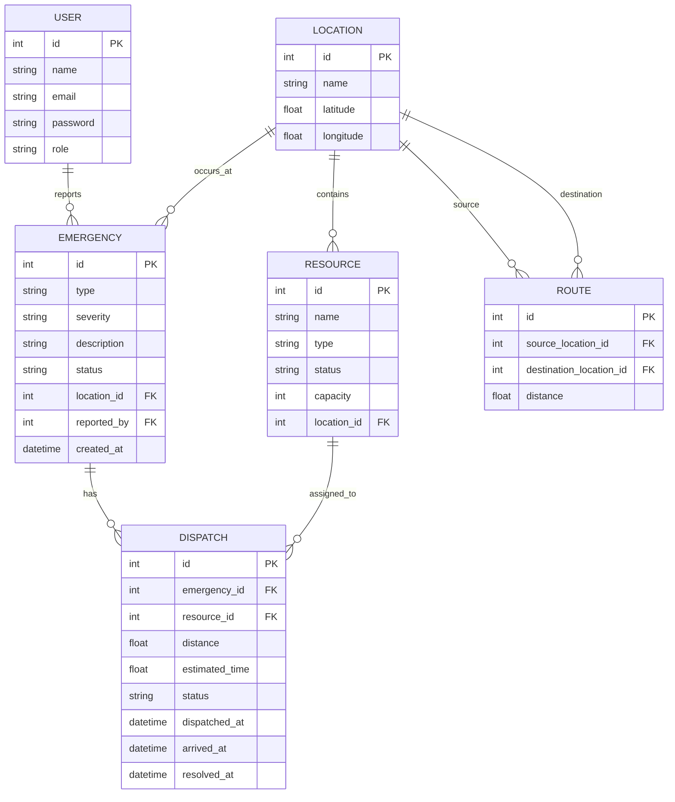

# Database / ER Design

## Smart Emergency Response and Resource Allocation System

This document describes the relational database structure implemented by the project.

> The diagrams below are based on the application's current SQLAlchemy models. They intentionally describe the implemented prototype rather than adding fields or relationships that are not currently present.

## 1. Entities

### User

| Field | Description |
|---|---|
| id | Primary key |
| name | User name |
| email | User email |
| password | Stored password field |
| role | User role |

### Location

| Field | Description |
|---|---|
| id | Primary key |
| name | Location name |
| latitude | Optional latitude |
| longitude | Optional longitude |

### Resource

| Field | Description |
|---|---|
| id | Primary key |
| name | Resource name |
| type | Resource type |
| status | Current resource status |
| capacity | Resource capacity |
| location_id | Foreign key to Location |

### Emergency

| Field | Description |
|---|---|
| id | Primary key |
| type | Emergency type |
| severity | Emergency severity |
| description | Optional description |
| status | Current emergency status |
| location_id | Foreign key to Location |
| reported_by | Optional foreign key to User |
| created_at | Creation timestamp |

### Route

| Field | Description |
|---|---|
| id | Primary key |
| source_location_id | Foreign key to Location |
| destination_location_id | Foreign key to Location |
| distance | Route distance |

### Dispatch

| Field | Description |
|---|---|
| id | Primary key |
| emergency_id | Foreign key to Emergency |
| resource_id | Foreign key to Resource |
| distance | Calculated dispatch route distance |
| estimated_time | Calculated estimated response time |
| status | Dispatch status |
| dispatched_at | Dispatch timestamp |
| arrived_at | Arrival timestamp |
| resolved_at | Resolution timestamp |

## 2. ER Diagram



## 3. Relationship Explanation

- One `User` can report many `Emergency` records.
- One `Location` can have many `Resource` records.
- One `Location` can have many `Emergency` records.
- A `Route` connects two `Location` records through source and destination foreign keys.
- One `Emergency` can have dispatch records.
- One `Resource` can appear in multiple dispatch records over time.

The `Route` table is especially important for the graph algorithm: each stored route becomes a weighted edge between two location nodes.

## 4. Graph Representation

For Dijkstra's algorithm:

```text
Location = Vertex / Node
Route    = Weighted Edge
Distance = Edge Weight
```

Example prototype network:

```text
Main Hospital
      |
     2 km
      |
Fire Station
      |
     3 km
      |
Police Station
      |
     2 km
      |
City Center

Main Hospital ───────── 6 km ──────── City Center
```

The graph is undirected in the current `Graph.add_edge()` implementation, so a stored route is available in both directions.

## 5. Database Design Notes

SQLite is used for the academic prototype because it is lightweight and requires no separate database server.

SQLAlchemy provides the ORM layer between Python objects and database tables.

The database file is local runtime data and should remain excluded from Git using:

```text
*.db
```
