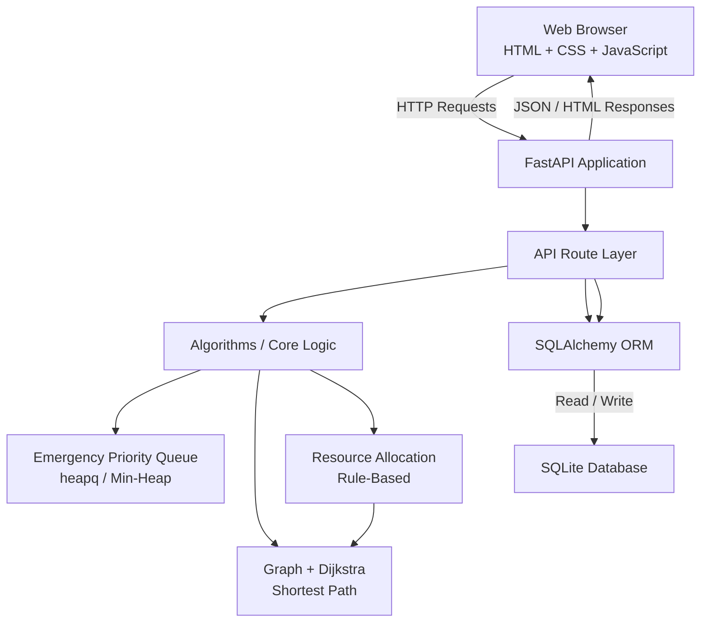

# System Architecture

## Smart Emergency Response and Resource Allocation System

## 1. Architecture Overview

The project follows a layered architecture:

```text
┌─────────────────────────────────────────────┐
│              Presentation Layer             │
│                                             │
│       HTML + CSS + JavaScript               │
│       FastAPI/Jinja2 Dashboard              │
└──────────────────────┬──────────────────────┘
                       │ HTTP / REST
                       ▼
┌─────────────────────────────────────────────┐
│                API Layer                    │
│                                             │
│                 FastAPI                     │
│  Locations | Resources | Emergencies       │
│  Priority | Routes | Dispatch | Tracking    │
└──────────────────────┬──────────────────────┘
                       │
                       ▼
┌─────────────────────────────────────────────┐
│          Business / Algorithm Layer         │
│                                             │
│  Priority Queue   Dijkstra   Allocation     │
│  Dispatch Lifecycle / ETA Calculation       │
└──────────────────────┬──────────────────────┘
                       │
                       ▼
┌─────────────────────────────────────────────┐
│             Data Access Layer               │
│                                             │
│                 SQLAlchemy                  │
│             ORM / DB Sessions               │
└──────────────────────┬──────────────────────┘
                       │
                       ▼
┌─────────────────────────────────────────────┐
│             Persistence Layer               │
│                                             │
│                  SQLite                     │
│          emergency_response.db              │
└─────────────────────────────────────────────┘
```

## 2. Mermaid Architecture Diagram



## 3. Component Responsibilities

### Frontend

Files:

```text
app/templates/dashboard.html
app/static/style.css
app/static/dashboard.js
```

Responsibilities:

- display system information,
- submit emergency requests,
- display resources,
- display dispatches,
- trigger dispatch assignment,
- update dispatch status,
- display analytics and priority information.

### FastAPI

File:

```text
app/main.py
```

Responsibilities:

- application startup,
- database table initialization,
- router registration,
- dashboard rendering,
- static-file configuration.

### API Routes

Directory:

```text
app/routes/
```

Responsibilities:

- receive HTTP requests,
- validate request data,
- access the database,
- invoke algorithmic logic,
- return structured responses.

### Algorithms

Directory:

```text
app/algorithms/
```

Contains:

```text
priority_queue.py
graph.py
resource_allocator.py
```

Responsibilities:

- emergency prioritization,
- shortest path calculation,
- resource selection.

### SQLAlchemy

Responsibilities:

- map Python models to database tables,
- create queries,
- persist records,
- retrieve records.

### SQLite

Responsibilities:

- persistent local storage for prototype data.

## 4. End-to-End Emergency Flow


## 5. Algorithm Interaction

```text
Emergency
    │
    ├── Severity ───────────────► Priority Queue
    │
    ├── Type ───────────────────► Resource Type Mapping
    │
    └── Location ───────────────► Dijkstra Destination
                                      ▲
                                      │
Resource ── Location ────────────────┘

Dijkstra result
    │
    ├── shortest distance
    └── shortest path
            │
            ▼
      Resource Allocation
            │
            ▼
         Dispatch
```

## 6. Why This Architecture

The architecture separates responsibilities so that:

- UI code does not contain database logic.
- API routes do not implement the entire graph algorithm.
- Algorithms can be tested independently.
- Database access is centralized through SQLAlchemy.
- Individual modules can be extended without rewriting the whole application.

This structure is appropriate for the current academic prototype and can later be evolved toward a larger deployment architecture.

## 7. Future Scaling Direction

A future production-oriented architecture could replace or extend:

```text
SQLite
```

with a server database such as PostgreSQL, add:

```text
Reverse Proxy / Load Balancer
Application Server(s)
PostgreSQL
Redis / Cache
WebSocket Service
External Mapping Service
Authentication Service
```

These components are future enhancements and are not required by the current prototype.
